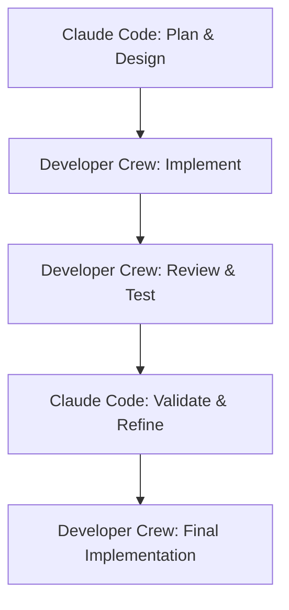

# MVP Execution Plan: A Two-Part Strategy

## Overview

This document outlines a two-part strategy to build the Adaptive Academy project. The core idea is to first build the tools, then use those tools to build the product.

1.  **Part 1: Build the AI Developer Crew.** We will first create an internal, AI-powered team of agents designed to automate our software development lifecycle. This is a reusable asset that acts as a force multiplier.
2.  **Part 2: Build the Adaptive Academy Application.** With the Developer Crew operational, we will then use it to build, test, and deploy the user-facing learning application.

This approach is designed to maximize development velocity, ensure high code quality through automated reviews and testing, and create a scalable development process.

## 🤖 Integration with Claude Code

The Developer Crew is designed to complement and amplify the capabilities of interactive AI coding assistants like Claude Code. Here's how they work together:

### **Claude Code as the Strategic Partner**
- **Planning & Architecture**: Use Claude Code for high-level planning, architectural decisions, and complex problem-solving
- **Interactive Development**: Real-time collaboration on complex logic, debugging, and iterative refinement  
- **Code Review & Analysis**: Deep analysis of existing codebases, understanding patterns, and strategic refactoring
- **Learning & Guidance**: Understanding new frameworks, best practices, and getting explanations

### **Developer Crew as the Execution Engine**
- **Automated Implementation**: Execute well-defined tasks autonomously (e.g., "Create CRUD endpoints for User model")
- **Batch Operations**: Handle repetitive tasks like file generation, boilerplate code, or mass refactoring
- **Quality Assurance**: Automated testing, code review, and validation pipelines
- **Workflow Automation**: Multi-step processes that can run unattended

### **Typical Workflow Integration**



**Example Scenario:**
1. **Claude Code Session**: "Help me design a FastAPI service with user authentication"
   - Discuss architecture, choose libraries, design endpoints
   - Create initial project structure and key files
   - Plan the implementation strategy

2. **Developer Crew Execution**: Hand off to autonomous agents
   ```bash
   uv run python -m developer_crew.main code "Implement JWT authentication middleware for FastAPI"
   uv run python -m developer_crew.main code "Create User model with SQLAlchemy and Pydantic schemas"
   uv run python -m developer_crew.main workflow "Build complete user registration endpoint"
   ```

3. **Claude Code Review**: Return for strategic oversight
   - Review the generated code for architectural alignment
   - Handle complex edge cases or business logic
   - Plan next phase of development

### **Benefits of This Approach**
- **Efficiency**: Handle routine tasks automatically while focusing human attention on complex problems
- **Consistency**: Standardized code patterns and quality checks across all generated code
- **Speed**: Parallel execution of multiple related tasks
- **Quality**: Multi-layer validation (code review + testing + human oversight)
- **Learning**: The Developer Crew learns patterns from Claude Code sessions and codifies them

---

## Part 1: Build the AI Developer Crew

### Overview

This phase focuses on creating our "AI factory"—a command-line tool that orchestrates a team of specialized AI agents to perform software engineering tasks.

### ✅ Phase 1: Foundation & The `Coder` Agent - **COMPLETED**

**Goal:** Create a single, functional agent that can write and modify code based on a precise instruction.

- [x] Create a new Python project directory: `developer_crew`.
- [x] Set up a `pyproject.toml` and modern uv-based virtual environment.
- [x] Install core dependencies: `autogen-agentchat>=0.7.4`, `autogen-ext[openai]`, `python-dotenv`, `typer`, `rich`.
- [x] Implement the `Coder` agent with a focused system prompt using modern async AutoGen API.
- [x] Implement comprehensive file system tools (`read_file`, `write_file`, `edit_file`, `list_files`, `get_project_structure`).
- [x] Create a rich CLI (`main.py`) with multiple commands: `code`, `review`, `init`, `test`.
- [x] Implement the `CodeReviewer` agent for static code analysis.
- [x] Add proper error handling, async support, and resource cleanup.

**Phase 1 Deliverable:** ✅ **DELIVERED** - A fully functional command-line tool with both `Coder` and `CodeReviewer` agents using the latest AutoGen 0.7.4 framework.

### ✅ Phase 2: Adding Guardrails - The `QA_Tester` and Orchestration - **COMPLETED**

**Goal:** Establish a quality control process by adding dynamic analysis and orchestration.

**Status Update:** All components successfully implemented and tested.

**Completed Tasks:**
- [x] Implement the `QA_Tester` agent with system prompt focused on code execution and validation.
- [x] Add comprehensive terminal/shell execution tools for the `QA_Tester` agent with security safeguards.
- [x] Create orchestration workflow: `Coder` writes -> `CodeReviewer` reviews -> `QA_Tester` validates.
- [x] Implement feedback loops where agents can communicate results to each other.
- [x] Add `workflow` command to CLI for running the full pipeline with customizable options.
- [x] Update agents to use modern AutoGen 0.7.4 API with direct tool assignment.
- [x] Add individual agent commands: `code`, `review`, `test` for targeted operations.

**New Tools & Features:**
- **Safe Command Execution**: Security-first approach with whitelist of allowed commands
- **Python Script Execution**: Run and test Python files with proper error handling
- **Test Framework Integration**: Support for pytest, unittest, and nose testing frameworks
- **Code Quality Checks**: Automated ruff, mypy, black, and flake8 integration
- **Rich CLI Interface**: Beautiful terminal output with progress indicators and structured results

**Phase 2 Deliverable:** ✅ **DELIVERED** - A complete three-agent pipeline with full orchestration, individual agent access, and comprehensive testing capabilities.

### Phase 3: Full Crew Orchestration

**Goal:** Build a fully autonomous, conversational development team that can manage a feedback loop.

- [ ] Implement the `Architect` agent for high-level planning.
- [ ] Implement the `Integrator` agent to act as the `GroupChatManager`, mediating the conversation.
- [ ] Set up an Autogen `GroupChat` containing all agents.
- [ ] Implement the full conversational workflow with feedback loops (e.g., `Reviewer` sends notes back to `Coder`).
- [ ] Configure a `UserProxyAgent` with `human_input_mode="ALWAYS"` to require final human approval.

**Phase 3 Deliverable:** A fully orchestrated agent crew that can take a high-level request, plan it, code it, test it, and present the final code for human approval.

### Phase 4: Polish & First Real Task

**Goal:** Refine the Developer Crew into a reusable tool and use it to build the foundation of the `adaptive-academy` application.

- [ ] Refine all agent system prompts based on performance in prior phases.
- [ ] Package the crew into a clean, reusable command-line interface.
- [ ] **First Task:** Use the newly built Developer Crew to execute the prompt: _"Scaffold a new FastAPI application in a directory named `agent_service`. It should have a health check endpoint at `/api/health`. Include a `README.md` and a `.gitignore` file."_

**Phase 4 Deliverable:** A polished, reusable AI developer tool and the initial, AI-generated project structure for the `adaptive-academy` application.

---

## Part 2: Build the Adaptive Academy Application

### Overview

With the Developer Crew operational, we will now build the user-facing application. The Developer Crew will be used to execute the tasks in this plan, turning high-level goals into production code.

### Phase 1: Foundation & Backend Setup

**Goal:** Create the core backend service and establish communication with the frontend.

- [ ] **Task for Dev Crew:** "Scaffold the FastAPI service." (Completed in Part 1, Phase 4).
- [ ] **Task for Dev Crew:** "Implement a single Autogen agent, the `TutorAgent`, with a basic system message. Create a basic API endpoint that takes a user prompt and initiates a conversation with this agent."
- [ ] **Task for Dev Crew:** "Integrate BAML into the project. Create a single BAML function `ExplainConcept` and generate the Python client."
- [ ] **Task for Dev Crew:** "Establish a WebSocket endpoint for streaming agent messages back to a client."

**Phase 1 Deliverable:** A running FastAPI service that can host a single Autogen agent, with BAML integrated and real-time communication established.

### Phase 2: Core MVP Agent Implementation

**Goal:** Implement the full team of application agents and their primary tools.

- [ ] **Task for Dev Crew:** "Implement Autogen versions of the `CurriculumDirector` and `AssessmentCoach` agents."
- [ ] **Task for Dev Crew:** "Create BAML functions for `GenerateCurriculum` and `CreateQuiz`."
- [ ] **Task for Dev Crew:** "Wrap all BAML functions as tools and register them with the appropriate agents."
- [ ] **Task for Dev Crew:** "Connect the Python service to a SQLite database. Create tools for the agents to read and write to the database."

**Phase 2 Deliverable:** The three core application agents are fully implemented and can use BAML and SQLite as tools.

### Phase 3: End-to-End Learning Flow

**Goal:** Create a complete, user-driven learning experience from start to finish.

- [ ] **Task for Dev Crew:** "Orchestrate the full agent `GroupChat` for the Application Crew."
- [ ] **Task for Dev Crew:** "Build the API endpoints required to manage a full learning session: start, get status, send message, end."
- [ ] **Task for Dev Crew:** "Work with the Next.js frontend team to integrate these API endpoints to display the agent conversation."

**Phase 3 Deliverable:** A user can start a session in the Next.js UI and have a complete, interactive learning conversation with the backend agents.

### Phase 4: Polish, Testing, and Documentation

**Goal:** Harden the application and prepare it for MVP release.

- [ ] **Task for Dev Crew:** "Implement robust error handling and structured logging across the Python service."
- [ ] **Task for Dev Crew:** "Write unit and integration tests for the core agent interactions and API endpoints."
- [ ] **Task for Dev Crew:** "Generate comprehensive API documentation."

**Phase 4 Deliverable:** A production-ready, tested, and documented MVP of the Adaptive Academy application.
