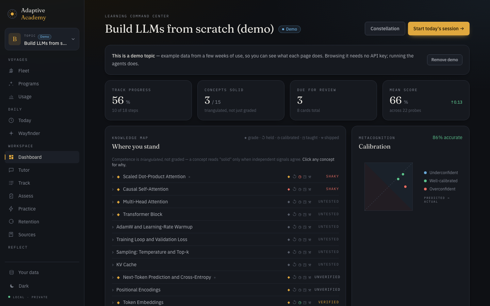
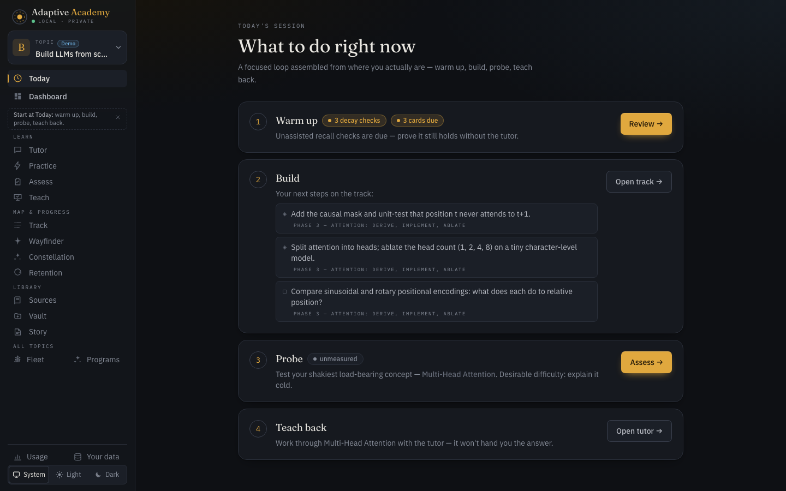
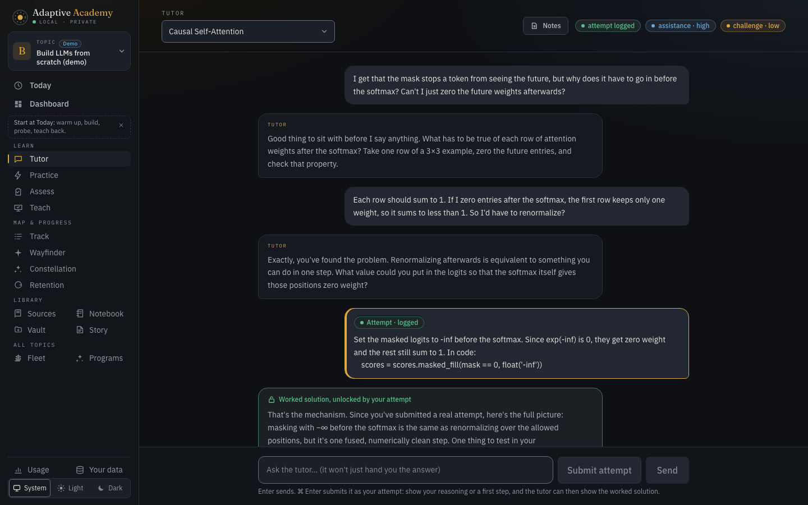
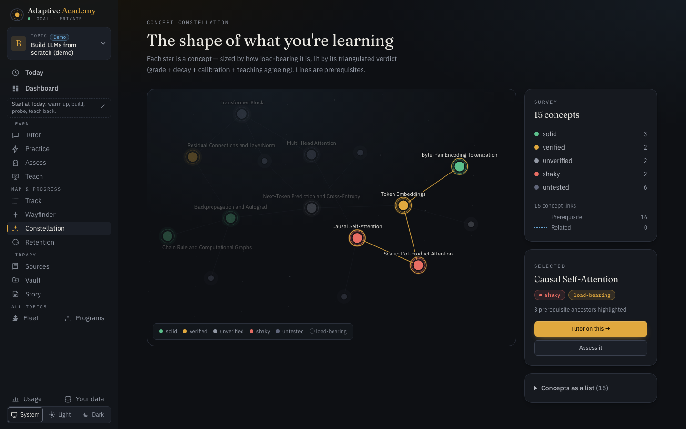
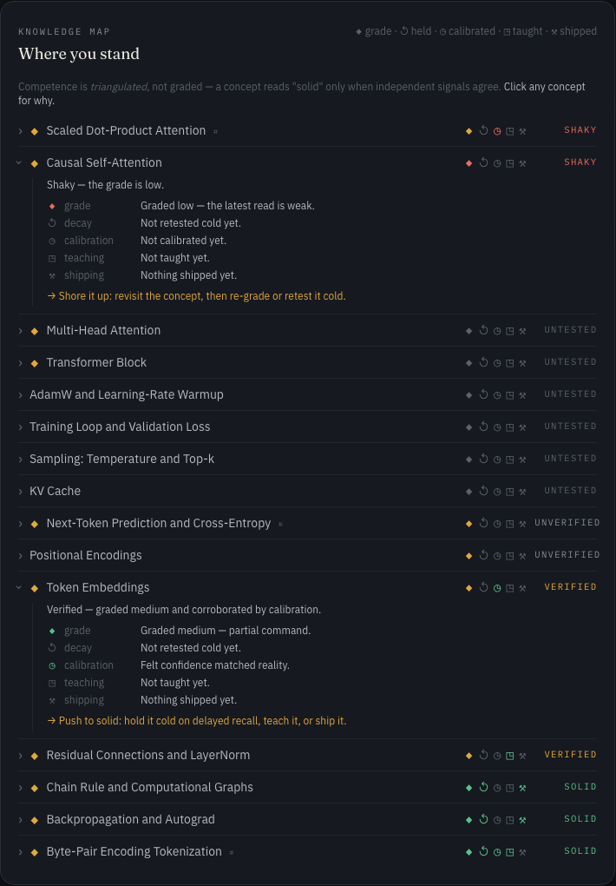

# Adaptive Academy

[](LICENSE)

A learning app you run on your own machine. Pick something to learn and it researches the topic,
builds a study plan, tutors you, and keeps track of what you actually know.

The tutor won't give you the answer until you've tried. That rule lives in the code, not just the
prompt.

It runs on your own Anthropic API key. Your learning records stay on your computer, but each AI
request is still sent to Anthropic.

## See it



This is the built-in demo topic. You can load it from the empty home page without an API key.
[Your first hour](docs/FIRST_HOUR.md) walks you through it.

| | |
|---|---|
|  |  |
| **Today**: what to do next, based on where you are. | **Tutor**: questions until you've made an attempt, then the full answer. (This one is a saved demo conversation. Browsing your past sessions is planned.) |
|  |  |
| **Constellation**: your concepts as a graph. | **Why this verdict**: what each concept's rating is based on, and what would raise it. |

There's also a [Usage page](docs/images/usage.png) and a [phone layout](docs/images/phone-today.png).
The demo makes no AI calls, so the Usage numbers in that screenshot are based on a real test run.

## What it does

- Builds a study plan for a topic, or for a longer goal split into milestones.
- Tutors you with questions and hints until you've made an attempt.
- Checks what you know in several ways: explaining it in your own words, recalling it days
  later, how sure you were, teaching it back, and things you build. A concept counts as solid
  only when these agree.
- Lets you practise under pressure: defend your ideas to a generated persona (a skeptical
  buyer, a thesis committee), or answer questions about a real paper.
- Tracks your momentum without punishing breaks.
- Reads your Obsidian notes and writes notes back.
- Remembers what you've read and what it already explained, so it doesn't repeat itself.
- Shows what each agent did and what each call cost.

## Get started

### With Docker

You need [Docker](https://docs.docker.com/get-docker/) or [OrbStack](https://orbstack.dev/),
and [`just`](https://github.com/casey/just).

```bash
cp .env.example .env   # then set ANTHROPIC_API_KEY=sk-ant-... in .env
just up
```

Open http://localhost:8000. `just logs` shows the logs and `just down` stops it.

### Without Docker

You need [`uv`](https://docs.astral.sh/uv/), Node.js 22.12+ (or 20.19+), and `just`.

```bash
just setup   # installs everything and creates .env; then set your key in .env
just dev     # starts the app; Ctrl-C stops it
```

Open http://localhost:5173.

Either way, [Your first hour](docs/FIRST_HOUR.md) is a good place to start. For everything
else (vault setup, Linux file ownership, ports, models, offline use), see
[docs/SETUP.md](docs/SETUP.md).

## Cost and privacy

Several agents work together, so it uses more tokens than a single chatbot. In one
measured run on Claude Sonnet 5.5, researching a new topic cost about 40 to 50 cents, and a
tutor turn cost about a cent. A busy day can reach a few dollars.

The **Usage** page shows what you've spent, by day, feature, and model. To set a daily limit,
add `AA_DAILY_BUDGET_USD=5` to `.env`. Details and limits of that cap are in
[docs/COSTS.md](docs/COSTS.md).

Your records are stored on your machine. There's no account and no telemetry. The content of
each AI request does go to Anthropic's API, and the app fetches the web pages and papers you
give it.

## Back up and restore your data

Everything is one SQLite file. Open **Your data** in the sidebar to download a backup, or run
`just backup`. Restoring is covered in [docs/BACKUP.md](docs/BACKUP.md).

## How it's built

Python, FastAPI, SQLite, and the Anthropic SDK on the back end; SvelteKit on the front end.

Each feature started as a written design and a step-by-step plan before any code. Those
documents are in the repo, and they explain the reasoning better than the code does:

- [Overview](docs/OVERVIEW.md): how the pieces fit together.
- [Research](docs/research/): the learning science behind the design, with sources.
- [Design specs](docs/superpowers/specs/) and [plans](docs/superpowers/plans/), one per feature.

## Contributing

It's early (pre-1.0), so expect rough edges. Issues, ideas, and pull requests are welcome. See
[CONTRIBUTING.md](CONTRIBUTING.md) for how to run the tests, and [ROADMAP.md](ROADMAP.md) for
what's planned. Please read the [Code of Conduct](CODE_OF_CONDUCT.md) and the
[security policy](SECURITY.md) too.

## License

[Apache 2.0](LICENSE) © 2026 Thomas Sullivan
